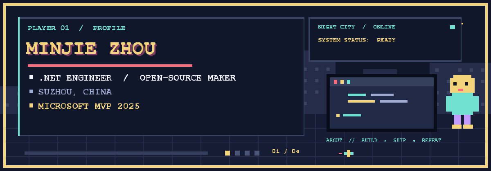

<p align="center">
  
</p>

<!-- Banner source: .github/scripts/generate_pixel_profile.py. Requires FreeMono fonts and .github/scripts/requirements.txt; regenerate with python .github/scripts/generate_pixel_profile.py --output assets/pixel-profile.gif. -->

<p align="center">
  <b>╔══════════════════════════════════════════════════════════════════╗</b><br/>
  <b>║  FULL-STACK DEVELOPER　·　MICROSOFT MVP 2025　·　OPEN-SOURCE　║</b><br/>
  <b>╚══════════════════════════════════════════════════════════════════╝</b>
</p>

<p align="center">
  <a href="https://www.cnblogs.com/kklldog/"></a>
  <a href="https://github.com/dotnetcore/AgileConfig"></a>
  <a href="https://github.com/kklldog?tab=followers"></a>
</p>

<p align="center"><code>「为写出能够装逼的代码而努力！」</code></p>

## ▰▰ PLAYER PROFILE

```text
┌───────────────────────────────────────────────────────────────┐
│  NAME      Minjie Zhou             CLASS    Full-stack dev    │
│  BASE      Suzhou, China           TITLE    Microsoft MVP     │
│  MAIN      .NET / C#               QUEST    Ship useful OSS   │
│  PASSIVE   Creating bugs since 2010   XP   +∞ and counting    │
└───────────────────────────────────────────────────────────────┘
```

### ▸ INVENTORY

`C#`　`ASP.NET`　`JavaScript`　`TypeScript`　`Java`

### ▸ QUEST LOG

| QUEST | DESCRIPTION | STATUS |
|:--|:--|:--:|
| [AgileConfig](https://github.com/dotnetcore/AgileConfig) | Lightweight distributed configuration center for .NET | `★ 1.6k+` |
| [AgileAI](https://github.com/kklldog/AgileAI) | Provider routing, streaming, tool calling & chat sessions for .NET | `BUILDING` |
| [AgileDT](https://github.com/kklldog/AgileDT) | Reliable messaging for distributed transactions | `SHIPPED` |
| [agileconfig-jclient](https://github.com/kklldog/agileconfig-jclient) | Java client for AgileConfig | `SHIPPED` |

### ▸ DAILY DROP

<p align="center">
  <picture>
    <source media="(prefers-color-scheme: dark)" srcset="https://raw.githubusercontent.com/kklldog/kklldog/output/github-snake-dark.svg" />
    <source media="(prefers-color-scheme: light)" srcset="https://raw.githubusercontent.com/kklldog/kklldog/output/github-snake.svg" />
    
  </picture>
</p>

<p align="center"><sub>Thanks for stopping by — now go build something fun.　▶ INSERT COIN</sub></p>
